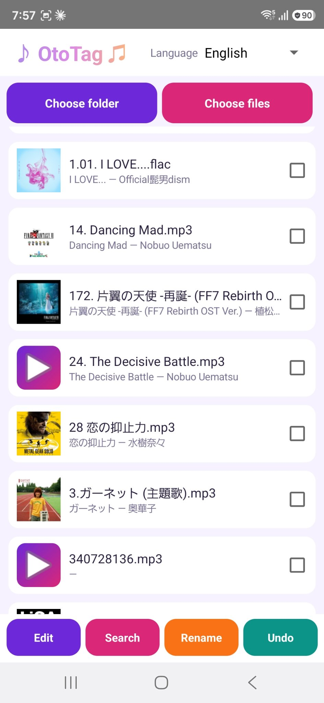
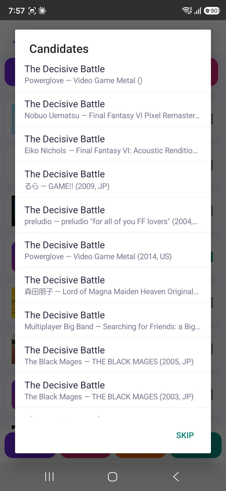
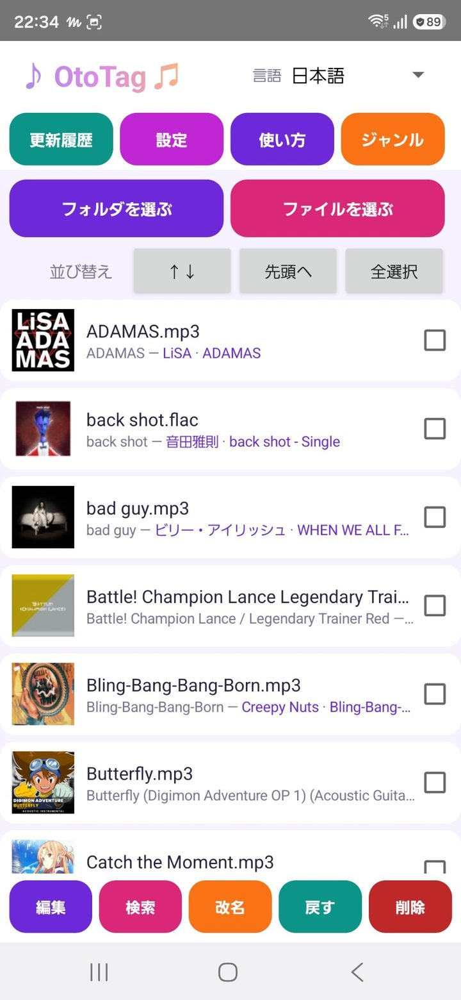
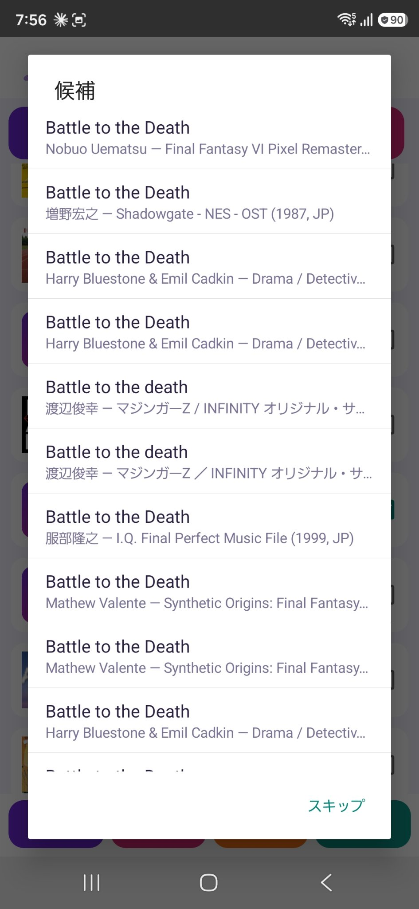

# ♪ OtoTag ♫

## English

OtoTag is a music tag editor for Android and Windows.

It fixes the tags of your music files, such as the title, artist, album and cover art.

It searches MusicBrainz and AnimeThemes for you, so most songs can be tagged with just a few taps.

### Features

- Edit title, artist, album, album artist, composer, genre, year, track and disc numbers, comment, ISRC and cover art.

- Supported formats are MP3, FLAC, M4A / MP4, OGG Vorbis and Opus.

- Search MusicBrainz by the current tags or by the file name, then pick the right candidate from the list.

- Search AnimeThemes, the anime opening and ending theme database, which is great for anime songs.

- The anime title becomes the album, and the theme slot such as OP1 or ED2 goes into the comment.

- Rename files by hand, or in bulk with a pattern such as "%track%. %title%".

- After a search applies tags, you can rename the file after the new tags in the same step.

- Select many files and apply searches one after another, editing shared fields in bulk.

- Every change is backed up first, so you can undo it later.

- Tap a song in the list to play it and check it before editing (Android).

- The interface is available in 12 languages and follows your system language by default.

### Screenshots

### Download

Get the Android APK and the Windows zip from the [latest release](https://github.com/yyoossk/ototag/releases/latest).

The Windows version needs no installation.

Just unzip it and run OtoTag.exe.

### How the search works

MusicBrainz is the main source and also provides cover art through the Cover Art Archive.

AnimeThemes covers anime theme songs that MusicBrainz sometimes misses.

If a file has no tags yet, OtoTag guesses the title and artist from the file name and the folder name.

Nothing is applied automatically.

You always pick the candidate yourself.

### Build from source

The shared core is written in Kotlin and is used by both apps.

The Android app is built with `android/build.sh` and the Windows app with `desktop/build.sh`.

See [docs/DESIGN.md](docs/DESIGN.md) for the design notes (in Japanese).

### License

MIT License.

---

## 日本語

OtoTag は、Android と Windows で使える音楽タグ編集アプリです。

曲名、アーティスト、アルバム、カバー画像といった音楽ファイルのタグを直せます。

MusicBrainz と AnimeThemes を検索して候補を出すので、ほとんどの曲は数タップでタグ付けできます。

### できること

- 曲名、アーティスト、アルバム、アルバムアーティスト、作曲者、ジャンル、年、トラック番号、ディスク番号、コメント、ISRC、カバー画像を編集できます。

- 対応形式は MP3、FLAC、M4A / MP4、OGG Vorbis、Opus です。

- 今のタグやファイル名から MusicBrainz を検索し、候補リストから正しいものを選べます。

- アニメの OP / ED 専門データベース AnimeThemes も検索できるので、アニソンに強いです。

- アニメ名がアルバムに入り、OP1 や ED2 といった主題歌の種別がコメントに入ります。

- ファイル名は手動で変えられるほか、「%track%. %title%」のようなパターンで一括変更もできます。

- 検索でタグを入れた直後に、そのタグに合わせてファイル名も変えられます。

- 複数ファイルを選んで、1曲ずつ連続で検索を適用したり、共通項目をまとめて編集したりできます。

- 変更前には必ずバックアップを取るので、あとから元に戻せます。

- 一覧で曲をタップすると再生できるので、編集前に中身を確認できます (Android)。

- 画面は12言語対応で、初期値はシステムの言語です。

### スクリーンショット

### ダウンロード

Android の APK と Windows の zip は、[最新のリリース](https://github.com/yyoossk/ototag/releases/latest)から入手できます。

Windows 版はインストール不要です。

zip を展開して OtoTag.exe を実行するだけです。

### 検索の仕組み

中心は MusicBrainz で、カバー画像は Cover Art Archive から取得します。

AnimeThemes は、MusicBrainz で見つかりにくいアニメの主題歌を補います。

タグがまだ無いファイルは、ファイル名とフォルダ名から曲名とアーティストを推測して検索します。

自動で確定することはありません。

候補は必ず自分で選ぶ方式です。

### ソースからビルド

共有コアは Kotlin で書かれていて、両方のアプリで使われています。

Android 版は `android/build.sh`、Windows 版は `desktop/build.sh` でビルドします。

設計メモは [docs/DESIGN.md](docs/DESIGN.md) にあります。

### ライセンス

MIT ライセンスです。
