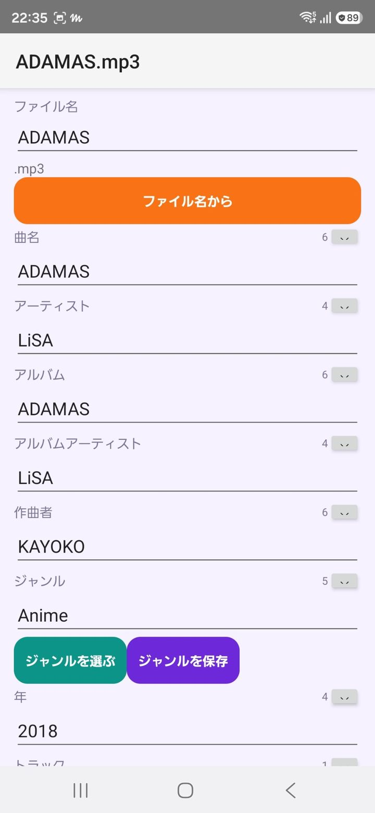
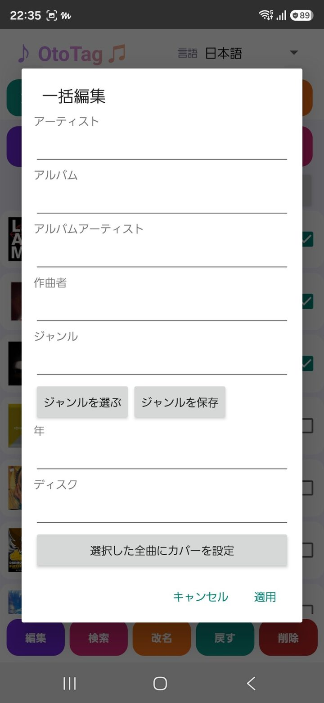

# ♪ OtoTag ♫

## English

OtoTag is a music tag editor for Android and Windows.

It fixes the tags of your music files, such as the title, artist, album and cover art.

It searches seven online databases for you, so most songs can be tagged with just a few taps.

This README describes version 20261128-2224.

### Features

- Edit title, artist, album, album artist, composer, genre, year, track and disc numbers, comment, ISRC, lyrics and cover art.

- Cover art can be picked from an image file, fetched from a URL, or pasted from the clipboard.

- Supported formats are MP3, FLAC, M4A / MP4, OGG Vorbis, Opus, WAV, AIFF and DSF.

- A file whose extension does not match its contents is detected by its contents and handled correctly.

- Search MusicBrainz (with cover art from the Cover Art Archive), iTunes, Deezer, AnimeThemes, VGMdb, Audius and the National Diet Library of Japan.

- Each search source can be switched on or off in the settings.

- Search by fingerprint with AcoustID, which matches the sound itself (a free personal API key is needed).

- Search by the current tags or by the file name.

- If nothing is found, you can search again with the title only or the artist only.

- Results appear in the list as they arrive, and a candidate you picked before is shown first the next time.

- Get lyrics from LRCLIB, Lyrics.ovh and Musixmatch (a free personal API key is needed for Musixmatch).

- When several lyrics are found, you can compare them side by side before choosing.

- Synced lyrics from LRCLIB can be saved as an .lrc file next to the song.

- AnimeThemes covers anime theme songs that other databases sometimes miss.

- The anime title becomes the album, and the theme slot such as OP1 or ED2 goes into the comment.

- There are 60 built-in genres, including Japanese ones such as anime songs, game music, Vocaloid, kayokyoku, enka and city pop.

- You can add your own genres from the genre picker or from the Genre button on the main screen.

- Genres you do not use can be removed with a confirmation, and restored later from the Removed genres screen, which also has Restore all at the top.

- Your own genres can also be deleted for good on that screen, again with a confirmation.

- Edit seven fields in bulk (artist, album, album artist, composer, genre, year and disc) across many songs at once, leaving the fields you keep empty unchanged.

- You can also set the same cover art on all selected songs at once.

- Rename files by hand, in bulk with a pattern such as "%track%. %title%", or strip the leading track number with one button.

- After a search applies tags, you can rename the file after the new tags in the same step, with or without the track number.

- A rename that would clash with an existing file stops and tells you why.

- Filter the list by missing pieces (no tags, no cover, errors, no title, no artist, no year, no lyrics) and sort it in ascending or descending order.

- The Select all button switches to Select none as soon as anything is checked.

- Recent folders and pinned folders make reopening a library quick, and subfolders can be included or left out.

- Garbled Japanese tags (mojibake) are repaired automatically when a file is read.

- Every change is backed up first as a small snapshot of the tags and cover, so you can undo it later.

- Tap a song in the list to play it and check it before editing (Android).

- In the editor, changed fields are highlighted, the character count is shown, and a review screen lists the changes before saving.

- The interface is available in 12 languages and follows your system language by default.

- There is a dark mode, an in-app help page and an update history, and new versions install through the built-in auto update.

### Screenshots

The screenshots show the Japanese interface.

### Download

Get the Android APK and the Windows zip from the [latest release](https://github.com/yyoossk/ototag/releases/latest).

The Windows version needs no installation.

Just unzip it and run OtoTag.exe.

### How the search works

MusicBrainz is the main source and also provides cover art through the Cover Art Archive.

iTunes and Deezer are strong for mainstream releases, VGMdb covers game music, Audius covers independent artists, and the National Diet Library covers Japanese releases.

If a file has no tags yet, OtoTag guesses the title and artist from the file name and the folder name.

If neither the tags nor the file name help, the AcoustID fingerprint search can still find the song from its sound.

Nothing is applied automatically.

You always pick the candidate yourself.

### Build from source

The shared core is written in Kotlin and is used by both apps.

The Android app is built with `android/build.sh` and the Windows app with `desktop/build.sh`.

See [docs/DESIGN.md](docs/DESIGN.md) for the design notes (in Japanese).

### License

MIT License.

---

## 日本語

OtoTag は、Android と Windows で使える音楽タグ編集アプリです。

曲名、アーティスト、アルバム、カバー画像といった音楽ファイルのタグを直せます。

7つのデータベースを検索して候補を出すので、ほとんどの曲は数タップでタグ付けできます。

この README は、バージョン 20261128-2224 時点の内容です。

### できること

- 曲名、アーティスト、アルバム、アルバムアーティスト、作曲者、ジャンル、年、トラック番号、ディスク番号、コメント、ISRC、歌詞、カバー画像を編集できます。

- カバー画像は、画像ファイルから選ぶほか、URL から取得したり、クリップボードから貼ったりできます。

- 対応形式は MP3、FLAC、M4A / MP4、OGG Vorbis、Opus、WAV、AIFF、DSF です。

- 拡張子と中身が違うファイルは、中身を見分けて正しく扱います。

- MusicBrainz（カバー画像は Cover Art Archive）、iTunes、Deezer、AnimeThemes、VGMdb、Audius、国立国会図書館サーチを検索できます。

- 検索に使うデータベースは、設定でそれぞれオン・オフできます。

- AcoustID の指紋検索にも対応し、音そのものから曲を探せます（無料の個人 API キーが必要です）。

- 今のタグからでも、ファイル名からでも検索できます。

- 候補が見つからないときは、タイトルだけ・アーティストだけで探し直せます。

- 検索結果は届いたものから順に一覧へ出て、前に選んだ候補は次回から先に表示されます。

- 歌詞は LRCLIB、Lyrics.ovh、Musixmatch から取得できます（Musixmatch は無料の個人 API キーが必要です）。

- 複数の歌詞が見つかったときは、並べて比べてから選べます。

- LRCLIB の同期歌詞は、.lrc ファイルとして曲の横に保存できます。

- アニメの OP / ED 専門データベース AnimeThemes も検索できるので、アニソンに強いです。

- アニメ名がアルバムに入り、OP1 や ED2 といった主題歌の種別がコメントに入ります。

- 既定のジャンルは60件あり、アニソン、ゲーム、ボーカロイド、歌謡曲、演歌、シティポップなど日本語のジャンルも入っています。

- 自分のジャンルは、ジャンルを選ぶ画面の一番上や、最初の画面の「ジャンル」ボタンから追加できます。

- 使わないジャンルは確認つきで削除でき、「削除したジャンル」の画面からいつでも戻せます。その画面の一番上には「全て戻す」もあります。

- 自分で追加したジャンルは、その画面で完全に削除することもできます（確認つき）。

- アーティスト、アルバム、アルバムアーティスト、作曲者、ジャンル、年、ディスクの7項目を、複数の曲にまとめて一括編集できます。空欄にした項目は元のままです。

- 選んだ全曲に、同じカバーをまとめて設定することもできます。

- ファイル名は手動で変えられるほか、「%track%. %title%」のようなパターンでの一括変更や、先頭のトラック番号を消すボタンもあります。

- 検索でタグを入れた直後に、そのタグに合わせてファイル名も変えられます。トラック番号を付けるかどうかも選べます。

- 改名先に同じ名前のファイルがあるときは、理由を表示して止まります。

- 一覧は、タグなし・カバーなし・エラー・タイトルなし・アーティストなし・年なし・歌詞なしで絞り込めます。並び替えは昇順・降順の切り替えつきです。

- 「全選択」ボタンは、1つでもチェックが入ると「全解除」に切り替わります。

- 最近開いたフォルダの履歴と、フォルダのピン留めがあります。サブフォルダを含めるかどうかも選べます。

- 文字化けしている古いタグは、読み込み時に自動で直します。

- 変更前には必ずバックアップを取ります（タグとカバーの小さな控えです）。あとから元に戻せます。

- 一覧で曲をタップすると再生できるので、編集前に中身を確認できます（Android）。

- 編集画面では、変更した欄の色が変わり、文字数も表示されます。保存する前に変更点の一覧で確認できます。

- 画面は12言語対応で、初期値はシステムの言語です。

- ダークモード、アプリ内の使い方ページと更新履歴があり、新しい版は自動更新で入れられます。

### スクリーンショット

### ダウンロード

Android の APK と Windows の zip は、[最新のリリース](https://github.com/yyoossk/ototag/releases/latest)から入手できます。

Windows 版はインストール不要です。

zip を展開して OtoTag.exe を実行するだけです。

### 検索の仕組み

中心は MusicBrainz で、カバー画像は Cover Art Archive から取得します。

iTunes と Deezer は一般の曲に強く、VGMdb はゲーム音楽、Audius はインディーズ、国立国会図書館サーチは日本の盤に強いです。

タグがまだ無いファイルは、ファイル名とフォルダ名から曲名とアーティストを推測して検索します。

タグもファイル名も手がかりにならないときは、AcoustID の指紋検索で音そのものから探せます。

自動で確定することはありません。

候補は必ず自分で選ぶ方式です。

### ソースからビルド

共有コアは Kotlin で書かれていて、両方のアプリで使われています。

Android 版は `android/build.sh`、Windows 版は `desktop/build.sh` でビルドします。

設計メモは [docs/DESIGN.md](docs/DESIGN.md) にあります。

### ライセンス

MIT ライセンスです。
